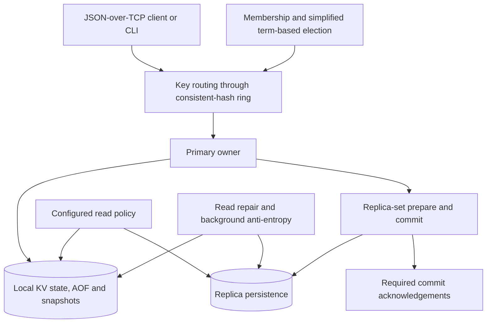

# MiniDB — Replicated Key-Value Datastore

[](https://github.com/Yumekaz/Mini-Redis-Cassandra/actions/workflows/verification.yml)
[](LICENSE)

**A Python datastore with consistent-hash sharding, replica-set writes, configurable reads and durable local persistence.**

MiniDB combines a Redis-like command interface with distributed ownership, replication, read repair, background anti-entropy, AOF persistence and snapshots. Its core runtime uses the Python standard library.

The repository name reflects design influences; MiniDB is an independent implementation, not a Redis/Cassandra distribution or wire-compatible replacement.

## Capabilities

| Area | Behavior |
| --- | --- |
| Data model | Key/value operations, TTL, key matching and statistics |
| Sharding | Consistent hashing with configurable virtual nodes |
| Replication | Primary-owner routing and replica-set acknowledgements |
| Read policies | ANY, ONE, QUORUM, ALL and primary-owner STRONG reads |
| Persistence | AOF logging, synchronously flushed committed entries and snapshots |
| Repair | Read repair plus a background anti-entropy manager |
| Cluster operations | Membership, simplified term-based election, rebalance and migration |
| Failure tooling | Built-in injection plus a first-party FailForge adapter |

The supported scope is controlled, small-cluster deployments. The consistency and security boundaries below are part of the implementation contract, not a claim of consensus-grade production safety.

## Quick start

Use Python **3.12 or 3.14**, the versions covered by CI. No third-party package is required to run the core datastore.

```bash
git clone https://github.com/Yumekaz/Mini-Redis-Cassandra.git
cd Mini-Redis-Cassandra
```

Run each node in a separate terminal from the repository root:

```bash
# Terminal 1
python3 -m minidb.main --node-id node1 --port 7001 --cluster-port 8001 --data-dir ./data/node1

# Terminal 2
python3 -m minidb.main --node-id node2 --port 7002 --cluster-port 8002 --data-dir ./data/node2 --seed localhost:8001

# Terminal 3
python3 -m minidb.main --node-id node3 --port 7003 --cluster-port 8003 --data-dir ./data/node3 --seed localhost:8001

# Terminal 4
python3 -m minidb.cli localhost 7001
```

On Windows, use `python` in place of `python3`. Wait for membership to settle before requesting a quorum operation. The automatic launchers are `./run.sh cluster` and `.\run_dbms.bat`; separate foreground terminals make process ownership and shutdown easier to inspect.

## Architecture

Membership/election and data replication are distinct responsibilities. A consistent-hash ring selects a key's primary owner and replica set.



Commands look familiar, but the network protocol is framed JSON over TCP rather than Redis RESP. Client applications should use MiniDB's own client/protocol.

## Command examples

```text
SET user:1 "Alice"
GET user:1
SETEX session:token 3600 "abc123"
GET user:1 QUORUM
CONSISTENCY QUORUM
NODES
RING
REPLICAS user:1
STATS
```

`CONSISTENCY` changes the CLI's default read policy; an explicit level on `GET` overrides it. See [CLI commands](docs/cli-commands.md) for the full interface.

Fault injection is intended for disposable clusters:

```text
FAULT ENABLE
FAULT DELAY 100
FAULT PARTITION node2
FAULT CLEAR
FAULT DISABLE
```

## Consistency and persistence contract

- QUORUM/ALL read thresholds use the configured replication factor, not a threshold silently reduced by a shrinking live ring.
- A committed write counts remote commit acknowledgements, not only successful prepare responses.
- Committed AOF records are flushed before acknowledgement. This covers the implemented commit path; it is not certification against every physical storage failure.
- Failed or timed-out writes may partially apply and must be treated as **indeterminate**.
- STRONG reads contact the key's primary owner; the name does not imply a globally linearizable consensus layer.
- Simplified elections do not provide consensus-grade split-brain fencing.
- Delete propagation is not Cassandra-style tombstone/compaction semantics.

The core does not provide TLS, authentication or authorization. Keep nodes on a trusted/private network and use a separately secured access layer if deployment requirements demand one.

[Consistency models](docs/consistency-models.md) · [Design decisions](docs/DESIGN_DECISIONS.md) · [Architecture](docs/ARCHITECTURE.md)

## Verification

Use a virtual environment for test dependencies:

```bash
python3 -m venv .venv
. .venv/bin/activate
python -m pip install pytest
python -m pytest -q tests
```

The October 8 retained acceptance run passed **33 tests** and FailForge seeds 42/43 with successful-operation and confirmed-fault requirements. The required [Verification workflow](.github/workflows/verification.yml) runs the complete suite on Python 3.12/3.14 and rejects prerequisite skips.

To run the linked failure campaign from a sibling FailForge checkout:

```bash
./bin/failforge run failforge_minidb.yml --seed 42
```

[FailForge](https://github.com/Yumekaz/FAILFORGE) uses its own pinned target revisions and private fixtures. See the [historical acknowledged-write postmortem](docs/postmortems/2026-07-failforge-seed42-raw.md) and [Cairn's validation record](https://github.com/Yumekaz/Cairn/blob/main/docs/VALIDATION_2026-10.md) for evidence and provenance. Selected seeds are not an exhaustive fault-schedule proof.

## Performance

This README does not claim a release-grade throughput or latency figure. Results depend on the revision, hardware, replication factor, read policy, persistence settings and workload.

The [benchmark protocol](docs/BENCHMARK.md) describes how to publish reproducible measurements. In particular, measure committed-write durability rather than comparing buffered writes with synchronously flushed acknowledgements.

## Design influences

- Redis-inspired command ergonomics, AOF logging and snapshots.
- Cassandra-inspired consistent hashing, replica placement and tunable read trade-offs.
- An independent small-cluster implementation with its own protocol and failure semantics.

These are architectural influences, not behavioral equivalence or a production feature-parity comparison.

## Source map

```text
minidb/
  cluster/     membership, election, replication and reads
  network/     framed TCP protocol and clients
  sharding/    consistent hashing, routing and migration
  storage/     key/value state, AOF and snapshots
  repair/      version/repair logic and anti-entropy
  chaos/       fault injection and rate limiting
tests/         persistence, consistency and cluster regressions
```

[Quickstart](docs/quickstart.md) · [Troubleshooting](docs/troubleshooting.md) · [FailForge](https://github.com/Yumekaz/FAILFORGE) · [Related Cairn stack](https://github.com/Yumekaz/Cairn/blob/main/docs/STACK.md)

## License

[MIT](LICENSE). MiniDB is not affiliated with Redis or Apache Cassandra.
